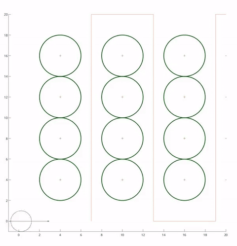
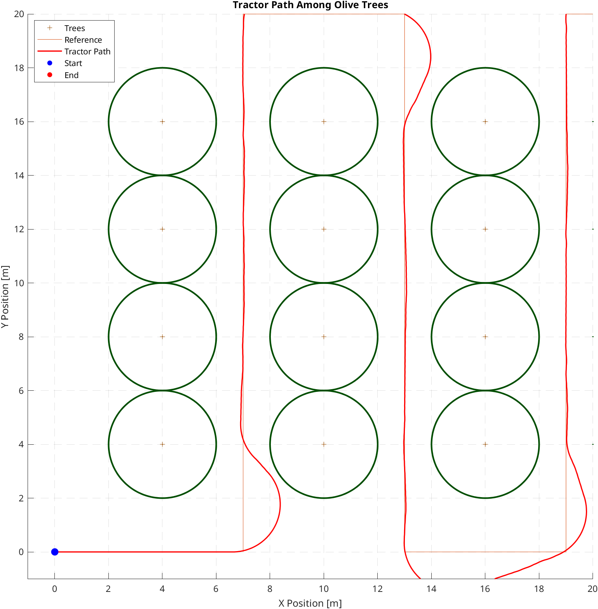

# An autonomous sprayer for an olive orchard

Control in Cyber-Physical Systems (CPCS), project I, 2025/2026 · MATLAB · by António Canteiro,
Filipe Cavalheiro and Rafael Louro.

## What

Automating a tractor that tows a sprayer through an olive orchard, in three steps of rising
difficulty: drive to a point, follow a row despite terrain disturbances, then carry out the whole
spraying job, delivering 8 ml to every tree within reach while keeping the cost per hectare low and
staying clear of the trees.

## How

The tractor is a nonlinear kinematic model with a towed trailer. The first step uses a linear
model-predictive controller; the full job uses a Lyapunov-based backstepping controller that
follows waypoints laid out between the rows at 40 km/h, with tractor and trailer integrated with
`ode45`. The spray is a half-disc behind the trailer, and its overlap with each tree's canopy,
integrated over time, gives the dose each tree received.

## Results

<table>
  <tr>
    <td width="50%"></td>
    <td width="50%"></td>
  </tr>
  <tr>
    <td>Simulation: tractor, hitch, trailer and spray area (blue) moving through the rows.
      (<a href="media/tractor.mp4">MP4</a>)</td>
    <td>The whole run: reference (thin line) and the path the tractor followed (red).</td>
  </tr>
</table>

Re-run in MATLAB R2024a.

## Contents

| Path | Content |
|---|---|
| `CPCS_Project_I.pdf` | The assignment |
| `Report/` | Report (`main.pdf`) and its LaTeX source |
| `ex1/` | Step 1: drive to a reference position (`exercise_1.m`) |
| `ex2/` | Step 2: line following robust to terrain disturbances (`exercise_2.m`) |
| `ex3/` | Step 3: the full spraying job (`main.m`) |
| `main_MPC.m` | Linear MPC tracking, an earlier approach |
| `tree_spray_intersect.m` | Spray-area / tree-canopy overlap and product per tree |
| `media/` | Video and figure above |

## Running

Open MATLAB in one of the `ex*` folders and run its main script (`exercise_1`, `exercise_2` or
`main`); each folder holds its own `init_vars.m`, controller and plotting code.

## License

GPL-3.0, see [LICENSE](LICENSE).
